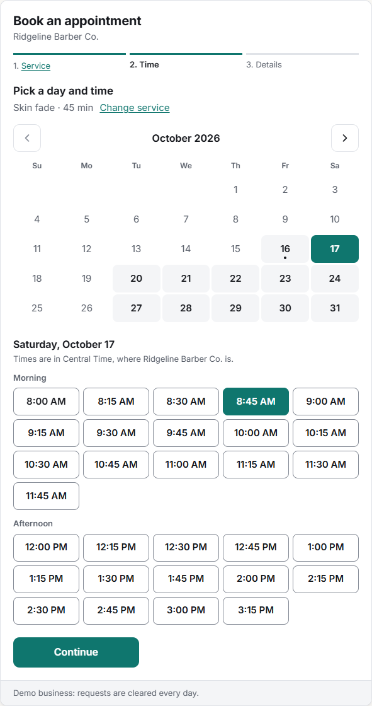
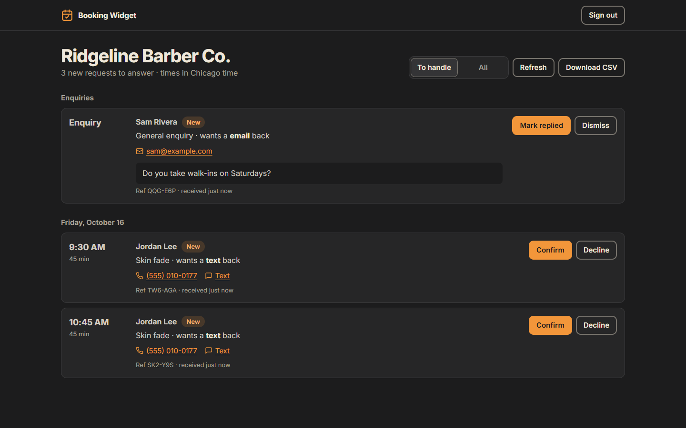

# booking-widget

Online booking for a small-business website in two lines of HTML, with a simple inbox for the owner.

Visitors pick a service, a day and an open time, leave a name and how they'd like to be contacted, and get a reference number and a calendar file. The owner gets an alert on Telegram, Discord, Slack or email, and confirms or declines from an inbox that works on a phone. It runs on Cloudflare Workers with a D1 database. A slot is held the moment it's requested, so two people can never book the same time.



**[Try the live demo](https://booking-widget.ebanigon-previews.workers.dev/)**: book a time at a made-up barber shop, change the colours and theme, then open the [owner inbox](https://booking-widget.ebanigon-previews.workers.dev/admin/?site=demo) with the key `ridgeline-demo` to confirm your own booking. Demo requests are cleared every day.

## Embed it

```html
<script src="https://your-worker.example/widget.js" defer></script>
<booking-widget site="your-business"></booking-widget>
```

| Attribute | Default | |
|---|---|---|
| `site` | | The business ID, the name of its file in `sites/` |
| `mode` | the site's `mode` | `booking` to pick a time, `enquiry` for a plain message form |
| `display` | `inline` | `inline` sits in the page, `popup` shows a button that opens a dialog |
| `accent` | `#0f766e` | Any hex colour (or set `--booking-accent` in CSS). Light colours get dark button text and a darker shade for links and focus rings, until each passes 4.5:1 contrast |
| `theme` | `light` | `light`, `dark` or `auto` (follows the visitor's setting) |
| `heading` | Book an appointment | The title on the card, or `none` to hide it |
| `button-label` | same as the heading | The popup's button |
| `api` | where `widget.js` came from | The Worker's address, if `widget.js` is served from somewhere else |

Any element with `data-booking-open` opens the popup, so a "Book now" link in the site's header can open it too (`data-booking-open="<site>"` picks one when a page has several). The widget fires a `booking:sent` event with the reference and details when a request is sent, for analytics.

It's one custom element in a Shadow DOM, so the site's CSS can't break it and it can't break the site. `widget.js` is about 14 KB gzipped, with no dependencies.

## What it does

- **Booking**: three steps with a progress bar: service, then day and time, then details. Times come from the business's hours, its time zone, the service's length, a minimum notice and closed dates. Visitors in another time zone see a note that the times are the business's.
- **Contact**: the visitor chooses call, text or email, and only the field that needs is required. Errors appear beside the field and are read out by screen readers.
- **No double booking**: each request holds every slot it covers in a table with a unique key, written in the same transaction as the request. Of two people who press Send at once, one gets the slot and the other is sent back to pick another time.
- **Spam**: a hidden honeypot field, a minimum time to fill in the form and five requests an hour per visitor. IP addresses are only stored as a salted daily hash and are wiped after two days.
- **The inbox** (`/admin/`): requests by day with tap-to-call, text and email links. Confirm, decline, mark done or cancel bookings, and mark enquiries replied or dismiss them. Declining or cancelling frees the slot again. Also exports a CSV.
- **Accessible**: full keyboard use (arrow keys move through the calendar), visible focus, labelled controls, reduced-motion support. axe finds nothing serious at phone and desktop widths.



## Set it up

Needs Node 20+ and a free Cloudflare account.

```
npm install
npx wrangler d1 create booking-widget
```

Put the `database_id` it prints into `wrangler.jsonc`. Then add a business:

```
npm run new-site -- ridgeline "Ridgeline Barber Co." America/Chicago
```

This writes `sites/ridgeline.json` and prints the owner's inbox key once. Only a hash of the key is saved, so the file is safe to commit. Edit the file for the business's hours, services and alerts:

```json
{
  "id": "ridgeline",
  "name": "Ridgeline Barber Co.",
  "timezone": "America/Chicago",
  "mode": "booking",
  "slotMinutes": 15,
  "noticeMinutes": 60,
  "daysAhead": 30,
  "hours": { "tue": [["09:00", "19:00"]], "sat": [["08:00", "16:00"]] },
  "closed": ["2026-12-25"],
  "services": [
    { "id": "classic-cut", "name": "Classic cut", "minutes": 30, "price": "$35", "description": "Scissor or clipper cut, wash and style." }
  ],
  "replyTime": "within 2 hours while we're open",
  "phone": "(555) 010-0148",
  "allowedOrigins": ["https://ridgelinebarber.example"],
  "notify": { "telegramChatId": "123456789" }
}
```

A day can have more than one range, for a lunch break. `allowedOrigins` limits which sites can send requests. The build checks every file and stops with a clear message if something is wrong.

### Alerts

| In `notify` | Also needs | |
|---|---|---|
| `telegramChatId` | `wrangler secret put TELEGRAM_BOT_TOKEN` | A message from your Telegram bot |
| `webhook` | | A Discord, Slack or any other webhook URL |
| `email`, `emailFrom` | `wrangler secret put RESEND_API_KEY` | An email through [Resend](https://resend.com/), from an address on a domain you've verified there |

Each alert has the request, the contact details and a link to the inbox. For local testing, put the secrets in `.dev.vars`, which git ignores.

### Run and deploy

```
npm run dev      # http://127.0.0.1:8787, with the demo page and a local database
npm run deploy   # applies the migrations to D1 and deploys the Worker
```

The Worker serves the demo page, `widget.js` and the inbox as static files, and the API under `/api/`. A daily cron removes the IP hashes and empties the demo business.

## How it works

- `src/widget/` is the custom element. `index.js` renders each step and talks to the API. `styles.js` has the light and dark tokens. `motion.js` animates only transform and opacity, and does nothing when the visitor asks for reduced motion. `scripts/build.mjs` bundles it with esbuild into `public/widget.js`.
- `src/shared/` is used by both the widget and the Worker: the time-zone maths (`time.js`, correct across daylight-saving changes), which times are open (`slots.js`), form validation (`validate.js`), accent contrast (`color.js`) and the site config check (`site.js`).
- `src/worker/index.js` is the API. It checks the origin, the body size and the rate limit, re-checks that the time is open, and writes the request and its holds in one batch. `notify.js` sends the alerts.
- `migrations/` has the D1 schema. `sites/*.json` is built into the Worker, so a change of hours is a commit and a deploy.

## Tests

```
npm test
```

Unit tests for open times, validation and colour contrast, including the theme tokens.

```
npm run dev
node test/e2e.mjs
```

The end-to-end test runs against the local server. It empties the local database, then checks the API (two requests for one slot at once, overlaps, spam, the rate limit, owner sign-in, freeing and retaking slots, the daily clean-up) and drives Chrome through a booking, an enquiry, the popup, dark mode and the inbox at 390px and 1440px, with axe and overflow checks on each. Screenshots go to `test/out/`.

## License

MIT. The demo page and inbox use [Inter](https://rsms.me/inter/), under the SIL Open Font License.
